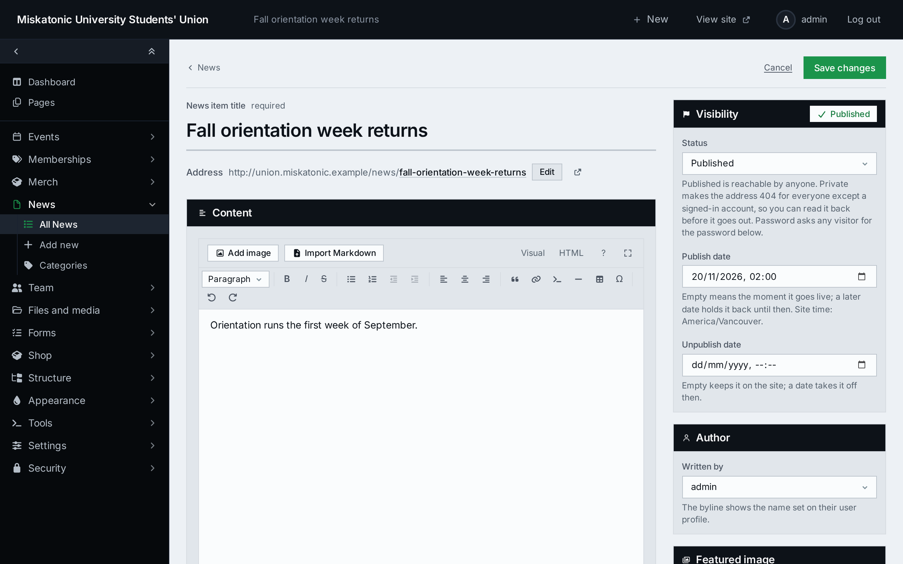
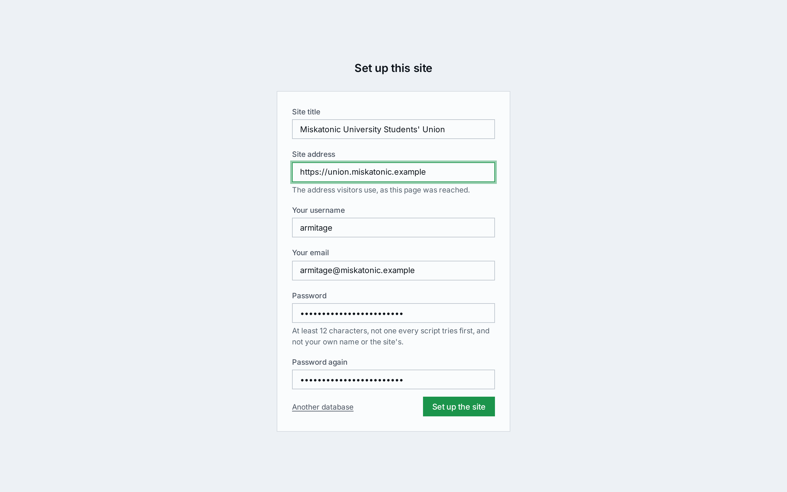
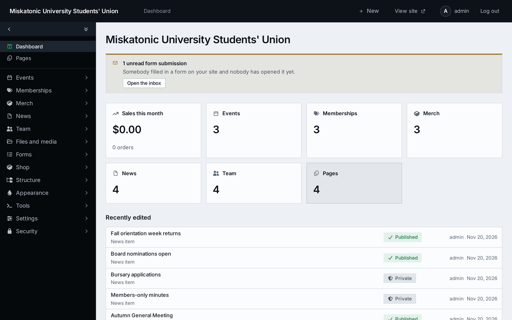
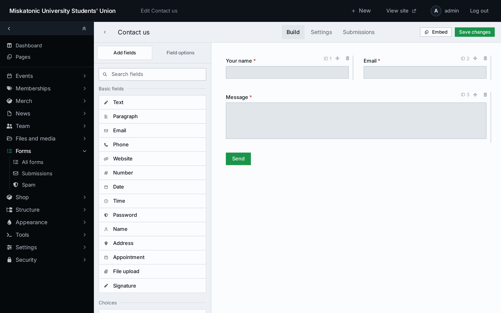
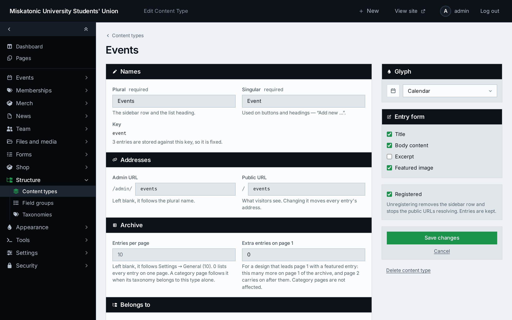

# Soba

A self-hosted content management system written from scratch in PHP.

It does what a typical WordPress site needs a dozen plugins for (custom content types, forms, a shop, SEO, a second language, backups and sign-in security) in one codebase, with no plugins, no framework and no build step. It runs on ordinary shared hosting, and a site owner who isn't technical can keep their own site up to date.



## Highlights

- **Built in, not bolted on.** Content types, forms, a shop, SEO, media, menus and translations are one system with one admin.
- **No third-party code at runtime.** Nothing loads from another company's servers unless the owner adds an embed or Google's tags. The two libraries it uses, FastRoute and PHPMailer, are included.
- **Safe updates.** Every update backs up the database and the files it replaces, refuses to overwrite files the site has changed, and rolls itself back if anything fails.
- **Modest requirements.** PHP 8.2 or later and MySQL or MariaDB. A static copy of the site runs where there is no PHP at all.

## A look inside

From an example site, for a fictional students' union.

| Setting up a new site | The dashboard |
| --- | --- |
|  |  |
| **Building a form** | **A content type of the site's own** |
|  |  |

## Features

- **Content:** custom content types and fields, categories and tags, parent and child entries, menus, revisions and undo, and Markdown import.
- **Two languages:** each page and entry can have a translation at the same address under a language prefix (`/fr/about`), with its own menus, search and sitemap. French ships with English.
- **Media:** a library with folders, images stored as WebP in responsive sizes, galleries, and embeds from YouTube, Vimeo, X, Instagram, Facebook, Google Maps, Calendly, Brevo and Kit.
- **Forms:** a form builder with multi-page forms, conditional fields, repeaters, uploads, ratings and appointments, plus a submissions inbox, spam filtering and a record of every email sent.
- **Mail:** sent through the server, an SMTP server or Brevo, with a test email that says what went wrong when one fails.
- **Shop:** products with variants, tax by province or state, delivery and pickup, discount codes, orders, refunds and exchanges, invoices, stock tracking, back-in-stock lists, sales and tax reports, product feeds for Google and Meta, and an API with webhooks. Payment is by bank transfer, cheque or on delivery; there is no card gateway yet.
- **SEO and analytics:** titles and descriptions with variables, structured data, a sitemap, redirects, and Google Analytics, Tag Manager and Search Console by ID.
- **Business details:** name, phone numbers, hours, location and service areas, entered once and used everywhere, structured data included.
- **Security:** roles, two-step and passwordless sign-in, temporary access, a movable sign-in page, lockouts, an audit log, and a check of the CMS's own files.
- **Operations:** scheduled backups, updates with rollback, a static copy of the whole site, WordPress import, and modules that can be switched off.

## Requirements

- PHP 8.2 or later, with the PDO MySQL, mbstring, DOM and fileinfo extensions. Two-step sign-in also needs OpenSSL, mail through Brevo needs curl, and a shop's webhooks need `allow_url_fopen`. Imagick, when present, is used for WebP.
- MySQL or MariaDB
- Apache with `mod_rewrite` (the rules are in `www/.htaccess`), or a server that sends every request that is not a file to `www/index.php`

The two PHP libraries the CMS uses, FastRoute and PHPMailer, are included in `admin/vendor/`. There is no Composer step.

## Installing

This repository is an installation: `admin/` holds the code and its configuration, and `www/` is the web server's document root.

1. Copy `admin/` and `www/` to the server, and point the document root at `www/`.
2. Create a database, and a user that may use it, in your host's control panel.
3. Open the site's address. It asks for the database, then the Site title and your own account, and writes `admin/config/config.php` with a long random `app_secret` of its own. Where the server will not let it write that file, it shows the text to save there yourself.
4. Sign in with the account you chose. The site starts with a Posts type, a first post and an About page, each edited or deleted like anything else.

Finish the set-up as soon as the files are on the server: until it is done, the first person to open the site's address can set it up.

Only a site that has never been set up opens that set-up. One that has run with a `config.php` and loses it answers with an error instead, so nobody else can point it at a database of theirs; put its `config.php` back.

From the command line instead: copy `admin/config/config.example.php` to `admin/config/config.php` and fill it in (the site's address, the database, a long random `app_secret`, and `'app_env' => 'production'` for a live site), then run `php admin/bin/migrate.php run`. It prints the password for the first sign-in, once, with the address of the sign-in page. Sign in there as `admin` with that password; the CMS asks for a name and password of your own straight away. A site that keeps its own router (below) is installed this way.

If that password is lost before anyone signs in, `php admin/bin/security.php password admin` prints a new one. The same command is the way back in for any account whose owner cannot sign in.

To move the sign-in page away from `/admin/login`, use Security → Login protection: type an address of your own, or press Randomize.

`php admin/bin/config.php set <key> <value>` changes one setting in `config.php` and keeps the rest of the file as it is, its comments included; `get` reads one and `unset` takes one out. The file is replaced only once the changed copy has been read back and found right.

A shop's unpaid orders are cancelled after the days Settings → Shop allows, and their customers reminded the day before, checked on visits at most every ten minutes. Where the host has cron, `php admin/bin/run-due.php` runs the same check on a timetable, so it happens on time on a quiet site.

## Updating

Each release is published on this repository's Releases page with an install package and an update package. To update a site, put the update package in the site's root and unpack it. It lands in `admin/updates/incoming/<version>/` and overwrites nothing:

```
tar -xzf soba-standalone-<version>-update.tar.gz --keep-old-files
php admin/updates/incoming/<version>/admin/bin/update.php check
php admin/updates/incoming/<version>/admin/bin/update.php apply
```

`check` says what will change and names any file the site has changed itself. `apply` backs up, updates, runs the release's migrations, and rolls everything back if a step fails.

Images added to the library before an update get their smaller widths from `php admin/bin/media-sizes.php`.

A library whose files were imported before imports kept their dates has them all dated the day they came in. `php admin/bin/media-dates.php` puts them back: `list` shows each file's dates, `set` changes them for a range of files, and `taken` reads each photo's date from the original files it was imported from.

Files a site already has under its web root, such as `/img/blog/x.jpg`, join the library where they are with `php admin/bin/media-site-files.php add`, followed by the files or a folder. Nothing is copied, moved or re-encoded, so each keeps its address, and its narrower copies beside it (`x-480.jpg`, `x-768.jpg`) are its widths. Editors then choose them like any other picture; removing one from the library leaves the file. `list` names them.

## A static copy

Tools → Static copy makes a copy of the site that needs no CMS, as one file to download: what is in it goes at the root of the address it was made for. The same from the command line, and from there on a host that does not let the admin start PHP:

```
php admin/bin/export-static.php https://www.example.com [--anywhere] [--no-php] [--instead="Email us at hello@example.com"]
```

- The copy's forms are sent by `forms/send.php`, which needs PHP 8.2 or later with mbstring and fileinfo, and its `forms/data/` folder writable. It mails each answer through the host's own mail program, with the visitor's files attached; `forms/config/config.php` takes an SMTP server's password instead.
- `--anywhere` ("Links that work anywhere" on the screen) makes every link relative, a page's naming its file (`news/index.html`), so the copy works at any address and opened from a folder with no web server, search included; its canonicals and sitemap still name the address given. Opened from a folder, a form shows the words given for it.
- For a host without PHP, `--no-php` (the tick-box on the screen) puts the words given in each form's place. They also stand in for a form the copy cannot send anywhere: one that books appointments, or names nobody to send to.
- A page behind a password is left out, and so are the basket, the checkout and customers' accounts: the shop's products are a catalogue.
- `.htaccess` carries the redirects and the not-found page for Apache; every host gets a page at each old address that sends the visitor on.
- What the copy could not take is listed when it is made.

## Beside a site that keeps its own router

A site may keep its own `www/index.php` and run the CMS beside it. Install from the release's router package (`soba-router-<version>-install.tar.gz`), whose front controller is `www/cms.php`, and have the site's router ask the CMS first:

```php
require __DIR__ . '/../admin/vendor/autoload.php';
if (\Cms\Site\Front::owns($_SERVER['REQUEST_URI'] ?? '/')) {
    require __DIR__ . '/cms.php';
    exit;
}
```

`owns()` answers for the admin, the API, private files, form posts, the sign-in page wherever it has moved, and every Content Type and taxonomy published at an address, under the second language's prefix too for those it translates. The site declares its own first segments in `admin/config/site-addresses.php`. Such a site updates from the release's router update package (`soba-router-<version>-update.tar.gz`), the same way.

A site's own header prints Google's measurement tags by calling `<?= \Cms\Site\Google::head() ?>` in its `<head>` and `<?= \Cms\Site\Google::body() ?>` straight after `<body>`, as a whole-page theme does. Each prints once a page, and nothing while Settings → SEO → Google is empty, so a site whose header already prints its own tags leaves it empty. `head()` takes the page's nonce when the site's Content-Security-Policy asks for one. A thank-you page of the site's own can ask `\Cms\Site\Google::conversion()` for the conversion a form's redirect left, before the page's first byte: it returns the event, the form's ID and the stored submission's ID, once, and null to a reload, another tab or a direct visit.

A site that prints its own tags and sends its own conversions sets `'site_sends_conversions' => true` in `config.php` and leaves Settings → SEO → Google empty. The CMS then prints nothing of Google's, and a real submission's conversion is still carried to the form's after-sending page ("After sending without JavaScript, go to", with "Go there after a send by script too" ticked for a form sent by script). A site's own form prints the form's hidden fields with `\Cms\Forms\Guard::fields()`, posts to `/forms/{id}/submit` with `Accept: application/json`, and reads `{success, message}`, plus `redirect`, the after-sending page as a path, to go to when there is one. A refusal adds `errors`, each field's message by its name, and `code`, the rule a post the guard turned away broke (`expired`, `too_fast` …).

Or the CMS draws and runs the form itself: a site's page prints the form placed at one of its places (`\Cms\Models\Form::byPlace('contact')`, drawn with `\Cms\Helpers\Shortcode::process('[form id="N"]')`) in the site's own markup, set on the form's Settings → On the page: the form's id and classes, its button's classes, each field's name as its id, its messages above or below it in a region that speaks, and each answer checked on the page in its field's own words (its autofill word, lines, empty choice and messages are the field's). A refusal without JavaScript comes back to that page with everything typed and each message under its field, and a page left open renews its token, so nothing typed is lost.

A whole-page theme that prints the site's title, tagline or footer text itself gets each in the language of the page it is drawing from `\Cms\Site\Language::option('site_footer_text')` (or `'site_name'`, `'site_tagline'`), and the page's language tag from `\Cms\Site\Language::current()`. Its link to the page in the other language is `\Cms\Site\Language::other()`: that language's tag, its name in itself, and the address, null on a site with one language.

A site that draws its own head around an entry it reads through the models gets what the entry's own page prints from `\Cms\SEO\Head::forEntry($post)`: its title, description, robots, social image and canonical address, every variable resolved. Its text, shortcodes run, is `\Cms\Models\Post::renderedContent($post)`. A whole-page theme draws a password-protected entry's gate with a `password` template of its own, handed the entry, the field to post (`$passwordField`) and whether the password given was wrong (`$passwordError`); without one the gate is the CMS's own.

A site whose own pages number their lists another way, `?p=2` say, names that in `config.php` (`'paging_parameter' => 'p'`), and the CMS's archives, term pages and front page number theirs the same way; a static copy follows it.

A site moving its form here from one that numbered its own leads keeps the numbers going: its history is imported with its own numbers, and `php admin/bin/form-numbers.php next 1001` makes the next new submission #1001, refused at or below the highest number used. History imported later below it keeps its own.

A site whose theme loads an icon font keeps the icons written into an entry's text, `<i class="fa-solid fa-phone" aria-hidden="true"></i>`, by naming the font's classes in `config.php` (`'icon_classes' => ['fa-solid', 'fa-regular', 'fa-brands', 'fa-*']`, a `*` standing for the rest of a name). Those classes and `aria-hidden="true"` are kept on `<i>` and `<span>`, empty as an icon is, and every other class, style and attribute still goes.

A template that draws its own `` gets any picture's address, size and alternative text, and the address of each narrower width, from `\Cms\Models\Media::image($id)`, all as paths from the site's root, so a site that answers on more than one host name loads them from itself. An entry's featured image is `Media::image($post['featured_image_id'])`.

## A site's own admin theme

The admin comes in three themes: Tuxedo, the default, and Midnight and Pearl, its dark and light versions. Each user chooses theirs on their own account, and an administrator can set anyone's.

A site adds its own as one stylesheet, `www/site/admin-themes/<key>.css`, where `<key>` is lower-case letters, digits and dashes. Updates never touch it. Write it the way Tuxedo's blocks are written in `www/admin/assets/css/tokens/signature-styles.css`: a `:root[data-theme="<key>"]` block with every token, and a comment line `Name: <name>`. For a top bar and sidebar of their own colours, add a block scoped to `.nav-top` and one scoped to `.nav-rail`, `.sb`, `.entity-rail-col` and `.nav-drawer`, each setting every token Tuxedo's do. A font or picture it uses goes beside it, named by a relative path. Then check it:

```
php admin/bin/admin-theme.php check www/site/admin-themes/<key>.css
```

It must say READY. It then appears on every account's Admin theme, and on Settings → Branding, which also sets the site's logo (a version for light backgrounds and one for dark) for the admin's top bar and its sign-in pages.

A site that offers only some of the themes names them in `config.php`, in the order the lists show them: `'admin_themes' => ['clientname', 'tuxedo']`. The first is the theme of every account that has not chosen one, and of any account whose choice is no longer offered. `php admin/bin/admin-theme.php list` shows which are offered.

## Issues

Report a problem or ask for a change by opening an issue. Pull requests aren't taken for now.

## Reporting a security problem

Email support@silverservers.com rather than opening a public issue. Say which release you found it in and how to reproduce it.

## Third-party components

- **Inter** and **Fira Mono** fonts, under the SIL Open Font License 1.1. The licence, with each font's copyright, is beside the fonts: `www/assets/fonts/OFL.txt` and `www/admin/assets/fonts/OFL.txt`.
- **Icons** by Font Awesome ([fontawesome.com](https://fontawesome.com)), under CC BY 4.0.
- **FastRoute** (BSD-3-Clause) and **PHPMailer** (LGPL-2.1), with their licences in `admin/vendor/`.

## Licence

Soba CMS is free software: you can redistribute it and/or modify it under the terms of the GNU General Public License as published by the Free Software Foundation, either version 3 of the License, or (at your option) any later version.

It is distributed in the hope that it will be useful, but WITHOUT ANY WARRANTY; without even the implied warranty of MERCHANTABILITY or FITNESS FOR A PARTICULAR PURPOSE. See the GNU General Public License for more details. Its full text is in `LICENSE`, and in every installation at `admin/LICENSE`.

Copyright (C) 2026 SilverServers. The third-party components above keep their own licences.
