<p align="center">
  <picture>
    <source media="(prefers-color-scheme: dark)" srcset="docs/brand/soba-lockup-color-on-dark.svg">
    
  </picture>
</p>

A self-hosted content management system written from scratch in PHP. Its website is [sobacms.com](https://sobacms.com).

It does what a typical WordPress site needs a dozen plugins for (custom content types, forms, a shop, SEO, a second language, backups and sign-in security) in one codebase, with no plugins, no framework and no build step. It runs on ordinary shared hosting, and a site owner who isn't technical can keep their own site up to date.

## Highlights

- **Built in, not bolted on.** Content types, forms, a shop, SEO, media, menus and translations are one system with one admin.
- **No third-party code at runtime.** Nothing loads from another company's servers unless the owner adds an embed or Google's tags. The two libraries it uses, FastRoute and PHPMailer, are included.
- **Safe updates.** Every update backs up the database and the files it replaces, refuses to overwrite files the site has changed, and rolls itself back if anything fails.
- **Modest requirements.** PHP 8.2 or later and MySQL or MariaDB. A static copy of the site runs where there is no PHP at all.

## Screenshots

Screens from an example site, with made-up content, in Carton, the default admin theme.

<p>
  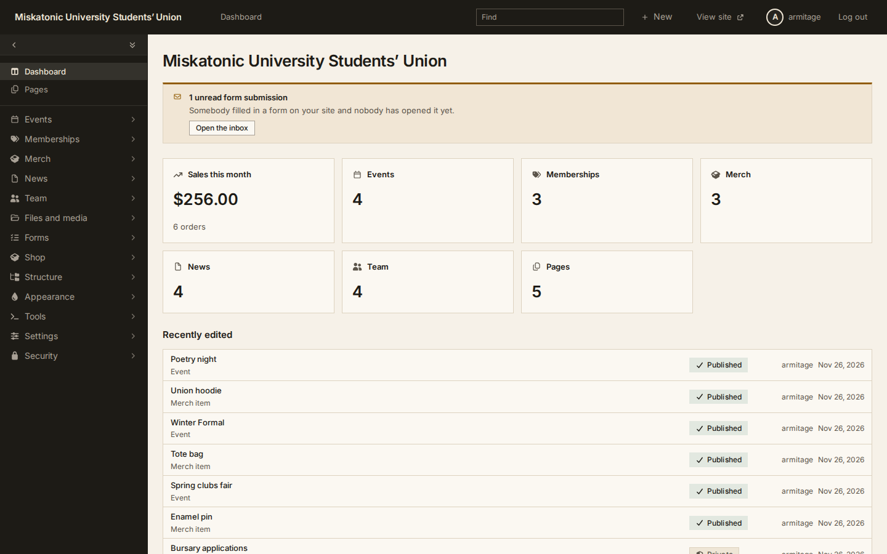
  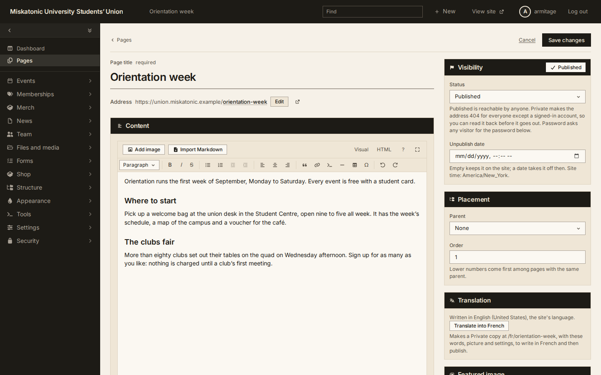
</p>
<p>
  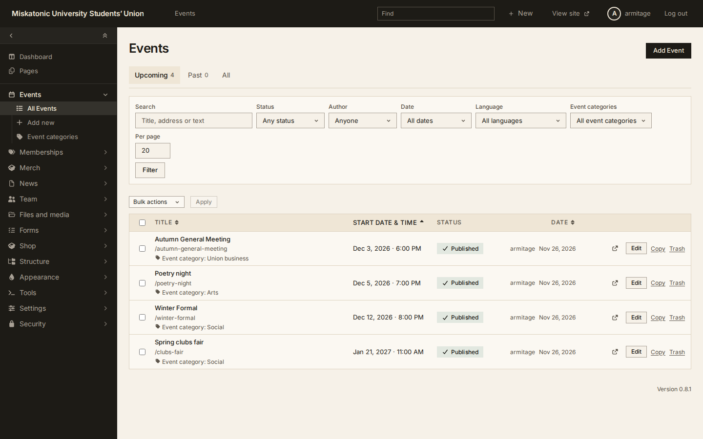
  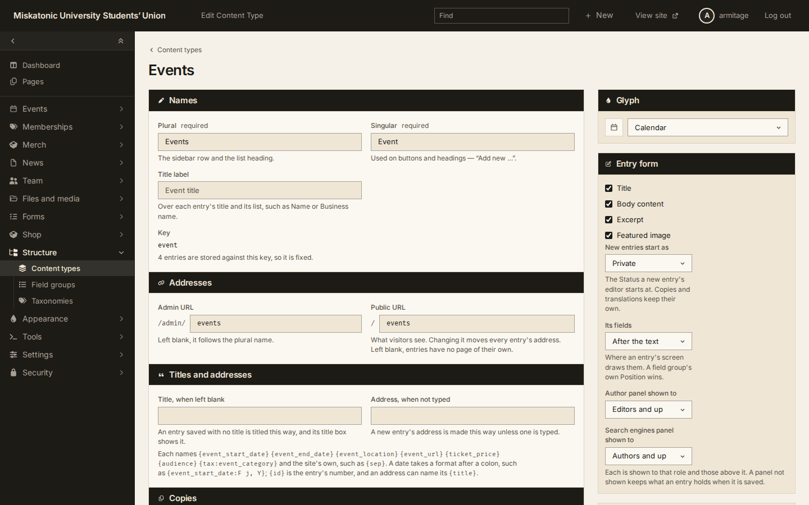
</p>
<p>
  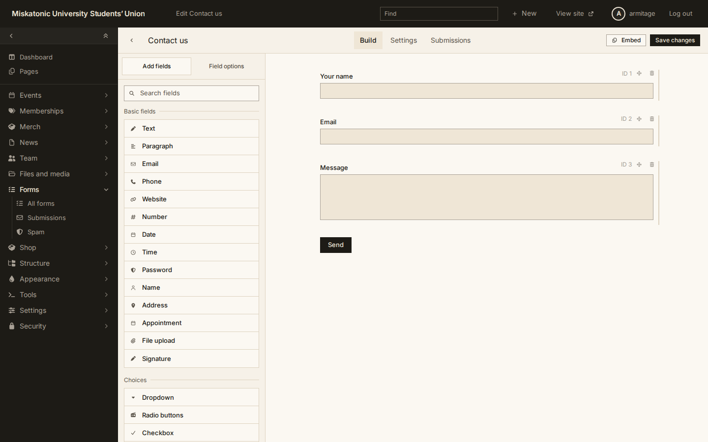
  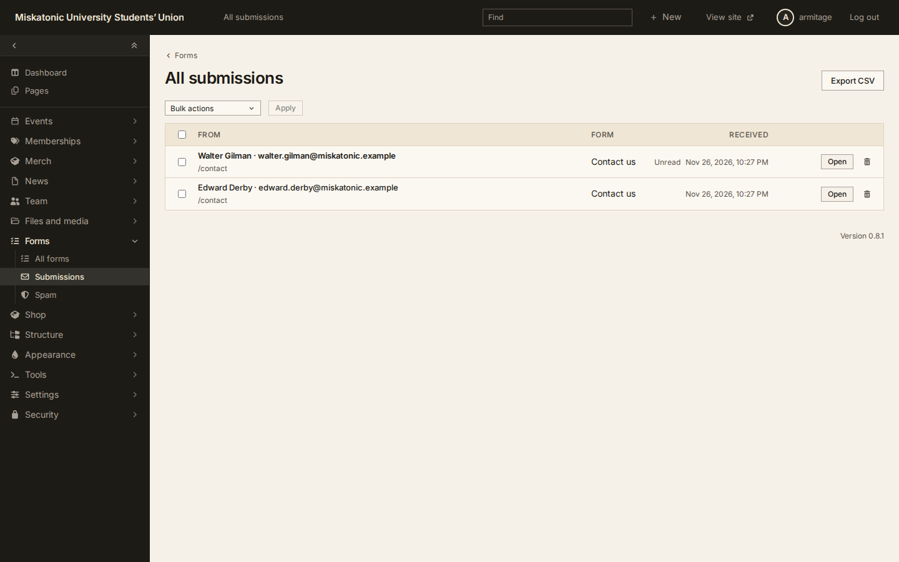
</p>
<p>
  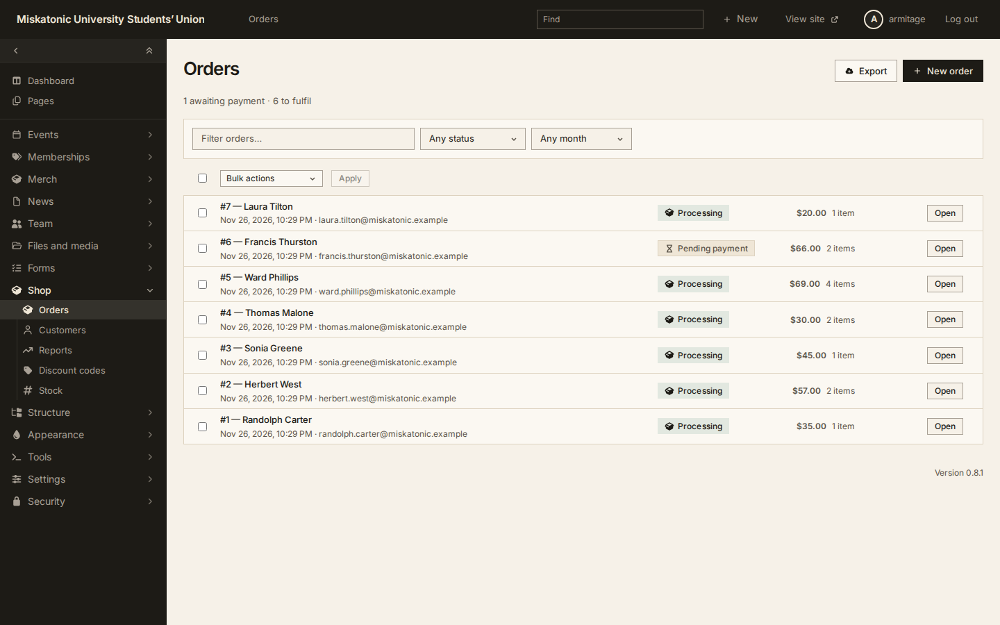
  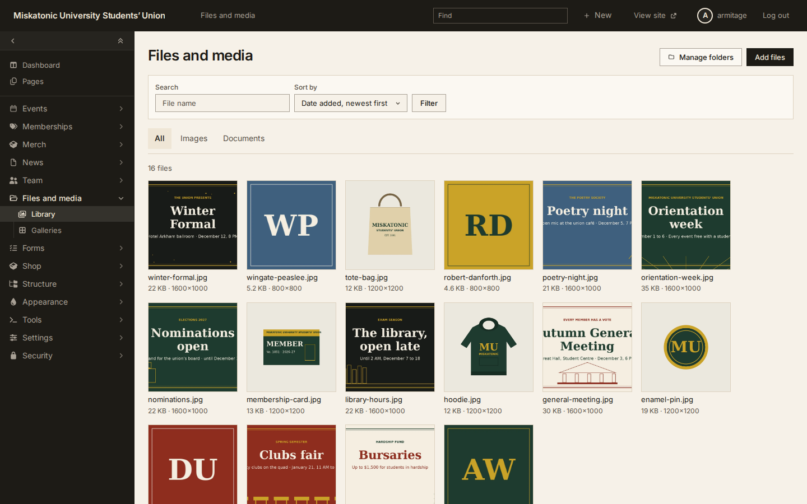
</p>
<p>
  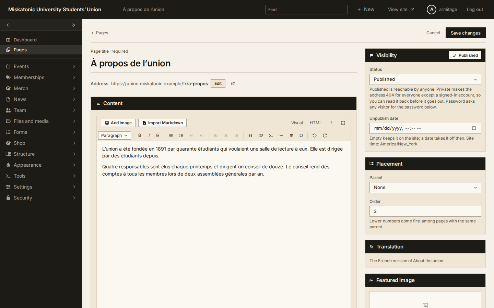
  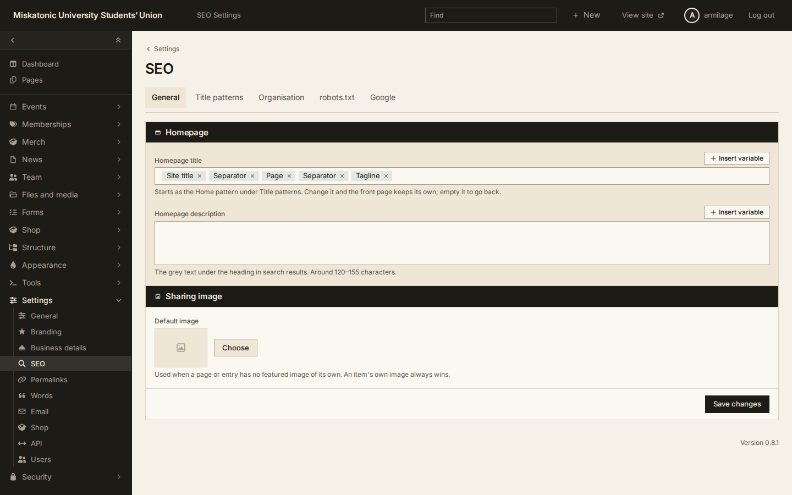
</p>
<p>
  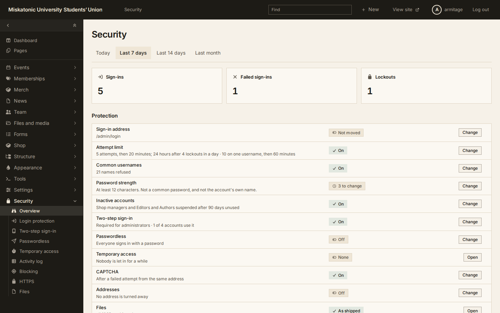
  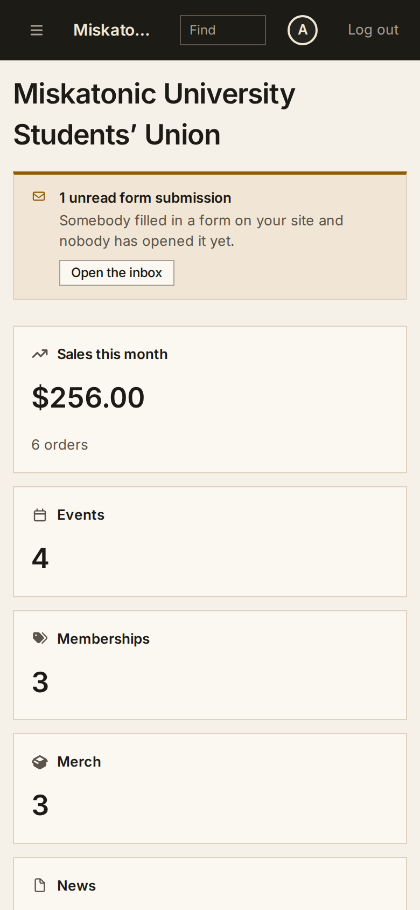
  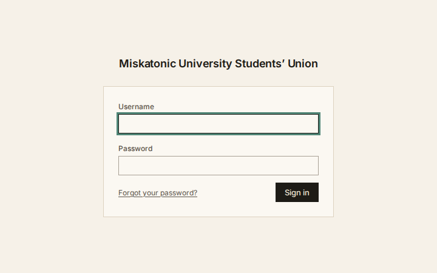
</p>

## Features

- **Content:** custom content types and fields, categories and tags with fields of their own, parent and child entries, announcements shown as a banner, a pop-up or a slide-in between their dates, menus, revisions and undo, and Markdown import.
- **Two languages:** each page and entry can have a translation at the same address under a language prefix (`/fr/about`), with its own menus, search and sitemap. French ships with English.
- **Media:** a library with folders, images stored as WebP in responsive sizes, file fields for PDFs and Office files, uploads of any size the site allows, many at once, a phone's HEIC photos taken as JPEG, galleries, and embeds from YouTube, Vimeo, X, Instagram, Facebook, Google Maps, Calendly, Brevo and Kit.
- **Forms:** a form builder with multi-page forms, conditional fields, repeaters, uploads, ratings and appointments, plus a submissions inbox, spam filtering and a record of every email sent.
- **Mail:** sent through the server, an SMTP server or Brevo, with a test email that says what went wrong when one fails.
- **Shop:** products with variants, tax by province or state, delivery and pickup, discount codes, orders, refunds and exchanges, invoices, stock tracking, back-in-stock lists, sales and tax reports, product feeds for Google and Meta, and an API with webhooks. Payment is by bank transfer, cheque or on delivery; there is no card gateway yet.
- **SEO and analytics:** titles and descriptions with variables, structured data, a sitemap, redirects, and Google Analytics, Tag Manager and Search Console by ID.
- **Business details:** name, phone numbers, hours, location and service areas, entered once and used everywhere: page text, search titles and descriptions, and structured data.
- **Security:** roles, two-step and passwordless sign-in, temporary access, a movable sign-in page, lockouts, an audit log, and a check of the CMS's own files.
- **Operations:** scheduled backups, updates with rollback, a static copy of the whole site, WordPress import, and modules that can be switched off.

## Requirements

- PHP 8.2 or later, with the PDO MySQL, mbstring, DOM and fileinfo extensions. Two-step sign-in also needs OpenSSL, mail through Brevo needs curl, and a shop's webhooks need `allow_url_fopen`. Imagick, when present, is used for WebP.
- MySQL or MariaDB
- Apache with `mod_rewrite` (the rules are in `www/.htaccess`), or a server that sends every request that is not a file to `www/index.php`

The two PHP libraries the CMS uses, FastRoute and PHPMailer, are included in `admin/vendor/`. There is no Composer step.

## Installing

This repository is an installation: `admin/` holds the code and its configuration, and `www/` is the web server's document root.

1. Copy `admin/` and `www/` to the server, and point the document root at `www/`.
2. Create a database, and a user that may use it, in your host's control panel.
3. Open the site's address. It asks for the database, then the Site title and your own account, and writes `admin/config/config.php` with a long random `app_secret` of its own. Where the server will not let it write that file, it shows the text to save there yourself.
4. Sign in with the account you chose. The site starts with a Posts type, a first post and an About page, each edited or deleted like anything else.

Finish the set-up as soon as the files are on the server: until it is done, the first person to open the site's address can set it up.

Only a site that has never been set up opens that set-up. One that has run with a `config.php` and loses it answers with an error instead, so nobody else can point it at a database of theirs; put its `config.php` back.

From the command line instead: copy `admin/config/config.example.php` to `admin/config/config.php` and fill it in (the site's address, the database, a long random `app_secret`, and `'app_env' => 'production'` for a live site), then run `php admin/bin/migrate.php run --admin-user=<your name> --admin-email=<your address>`. It prints the password for the first sign-in, once, with the address of the sign-in page. Sign in there with that name and password. The name and address follow the browser set-up's rules, and a name every script tries first, such as `admin`, is refused. Without the two options the first account is named `admin`, and the CMS asks for a name and password of your own at the first sign-in. A site that keeps its own router (below) is installed this way.

If that password is lost before anyone signs in, `php admin/bin/security.php password <name>` prints a new one. The same command is the way back in for any account whose owner cannot sign in.

To move the sign-in page away from `/admin/login`, use Security → Login protection: type an address of your own, or press Randomize.

`php admin/bin/config.php set <key> <value>` changes one setting in `config.php` and keeps the rest of the file as it is, its comments included; `get` reads one and `unset` takes one out. The file is replaced only once the changed copy has been read back and found right.

A shop's unpaid orders are cancelled after the days Settings → Shop allows, and their customers reminded the day before, checked on visits at most every ten minutes. Where the host has cron, `php admin/bin/run-due.php` runs the same check on a timetable, so it happens on time on a quiet site.

Tools → Backups makes a backup of the database and the uploads every day or every week, or now, and keeps the newest few in `admin/backups/`. To keep a copy of each off the server as well, name S3-compatible storage (Amazon S3, Backblaze B2, Wasabi and the like) in config.php's `backup_copy`, as `config.example.php` shows: each finished backup is copied there, a large one in parts over the next visits or cron runs, and the newest few are kept there, its `keep` or Tools → Backups' own number. Tools → Backups and System health say how each copy went. `config.php` is never in a backup, so keep a copy of it apart from them.

Before a site goes live, Tools → System health says what changes when `app_env` becomes production. On a copy that is not production it lists the accounts that will be asked for a new password or to set up two-step sign-in, Google's tags that will start sending, and how mail will go out. In production it warns of what a live site should not be left with: an administrator who never signed in, an account still on its first or a one-time password, two-step sign-in the policy requires and an account has not set up, temporary access still running, mail that cannot go or did not, no From address, backups older than their timetable, no cron run of `run-due.php` in the last day, backups kept only on the server, requests through a proxy `trusted_proxies` does not name, links still naming an address the site ran at before (Replace makes each the site's own, and every page and entry it changes keeps a revision from before), Business details typed out instead of their shortcode or variable, and sample entries. `php admin/bin/health.php` prints the same and exits 1 while anything needs attention, so a launch can rest on one command.

## Updating

Each release is published on this repository's Releases page with an install package and an update package. To update a site, put the update package in the site's root and unpack it. It lands in `admin/updates/incoming/<version>/` and overwrites nothing:

```
tar -xzf soba-standalone-<version>-update.tar.gz --keep-old-files
php admin/updates/incoming/<version>/admin/bin/update.php check
php admin/updates/incoming/<version>/admin/bin/update.php apply
```

`check` says what will change and names any file the site has changed itself. `apply` backs up, updates, runs the release's migrations, and rolls everything back if a step fails.

Images added to the library before an update get their smaller widths from `php admin/bin/media-sizes.php`.

A library whose files were imported before imports kept their dates has them all dated the day they came in. `php admin/bin/media-dates.php` puts them back: `list` shows each file's dates, `set` changes them for a range of files, and `taken` reads each photo's date from the original files it was imported from.

Files a site already has under its web root, such as `/img/blog/x.jpg`, join the library where they are with `php admin/bin/media-site-files.php add`, followed by the files or a folder. Nothing is copied, moved or re-encoded, so each keeps its address, and its narrower copies beside it (`x-480.jpg`, `x-768.jpg`) are its widths. Editors then choose them like any other picture; removing one from the library leaves the file. `list` names them.

## A static copy

Tools → Static copy makes a copy of the site that needs no CMS, as one file to download: what is in it goes at the root of the address it was made for. The same from the command line, and from there on a host that does not let the admin start PHP:

```
php admin/bin/export-static.php https://www.example.com [--anywhere] [--no-php] [--instead="Email us at hello@example.com"]
```

- The copy's forms are sent by `forms/send.php`, which needs PHP 8.2 or later with mbstring and fileinfo, and its `forms/data/` folder writable. It mails each answer through the host's own mail program, with the visitor's files attached; `forms/config/config.php` takes an SMTP server's password instead.
- `--anywhere` ("Links that work anywhere" on the screen) makes every link relative, a page's naming its file (`news/index.html`), so the copy works at any address and opened from a folder with no web server, search included; its canonicals and sitemap still name the address given. Opened from a folder, a form shows the words given for it.
- For a host without PHP, `--no-php` (the tick-box on the screen) puts the words given in each form's place. They also stand in for a form the copy cannot send anywhere: one that books appointments, or names nobody to send to.
- A page behind a password is left out, and so are the basket, the checkout and customers' accounts: the shop's products are a catalogue.
- `.htaccess` carries the redirects and the not-found page for Apache; every host gets a page at each old address that sends the visitor on.
- What the copy could not take is listed when it is made.

## Beside a site that keeps its own router

A site may keep its own `www/index.php` and run the CMS beside it. Install from the release's router package (`soba-router-<version>-install.tar.gz`), whose front controller is `www/cms.php`, and have the site's router ask the CMS first:

```php
require __DIR__ . '/../admin/vendor/autoload.php';
if (\Cms\Site\Front::owns($_SERVER['REQUEST_URI'] ?? '/')) {
    require __DIR__ . '/cms.php';
    exit;
}
```

`owns()` answers for the admin, the API, private files, form posts, the sign-in page wherever it has moved, and every Content Type and taxonomy published at an address, under the second language's prefix too for those it translates. The site declares its own first segments in `admin/config/site-addresses.php`. Such a site updates from the release's router update package (`soba-router-<version>-update.tar.gz`), the same way.

On Apache 2.4 with PHP-FPM, a plain `Header set` in the site's `.htaccess` sends a second copy of a header beside the CMS's own: two `X-Content-Type-Options` on every answer of the CMS's, and on the admin a second `X-Frame-Options` and `Referrer-Policy` beside its `DENY` and `same-origin`. Set each header only where the answer has none:

```apache
Header set X-Content-Type-Options "nosniff" "expr=-z resp('X-Content-Type-Options')"
Header set X-Frame-Options "SAMEORIGIN" "expr=-z resp('X-Frame-Options')"
Header set Referrer-Policy "strict-origin-when-cross-origin" "expr=-z resp('Referrer-Policy')"
```

`Header always setifempty` stops the second copy too, but it moves those headers ahead of the others and adds them to Apache's own redirects and error pages.

`mod_expires` gives every successful answer that has no `Expires` header a `Cache-Control: max-age` and an `Expires` of its own, whatever `Cache-Control` the answer already has. The CMS sends an `Expires` with each of its cache headers, which `mod_expires` leaves alone, so a site with `ExpiresActive On` needs nothing more. 0.8.0 sent no `Expires`, so its answers carried two `Cache-Control` headers: a form's token said `no-store` and a day's `max-age` at once. A site still on 0.8.0 switches `mod_expires` off for the CMS's own answers:

```apache
<IfModule mod_expires.c>
    <If "%{REQUEST_FILENAME} =~ m#/index\.php$# && %{THE_REQUEST} =~ m#^[A-Z]+ /(admin|api/v1|files|forms|assets/theme)([/? ]|$)#">
        ExpiresActive Off
    </If>
</IfModule>
```

`THE_REQUEST` is the address as it was asked for, before the site's rewrite to `index.php`, and the test of `REQUEST_FILENAME` leaves the CMS's real files, under `/admin/assets/` and `/assets/`, to the site's own caching. A site whose front controller is not `/index.php` changes both. Releases after 0.8.0 do not need the block.

A site's own header prints Google's measurement tags by calling `<?= \Cms\Site\Google::head() ?>` in its `<head>` and `<?= \Cms\Site\Google::body() ?>` straight after `<body>`, as a whole-page theme does. Each prints once a page, and nothing while Settings → SEO → Google is empty, so a site whose header already prints its own tags leaves it empty. `head()` takes the page's nonce when the site's Content-Security-Policy asks for one. A thank-you page of the site's own can ask `\Cms\Site\Google::conversion()` for the conversion a form's redirect left, before the page's first byte: it returns the event, the form's ID and the stored submission's ID, once, and null to a reload, another tab or a direct visit.

Announcements, such as a closure, an urgent notice or a sale, are entries of a type with the Announcement archetype, made on Structure → Content types; such a type has no pages. Each says how it shows (a banner across the top, a pop-up over the page, a slide-in at the corner, or in a place the theme has), its tone, a link and its button's words, the pages it shows on, one address a line (`/` the front page, `/about` a page, `/events/*` every page under it; blank, every page), the pages it never shows on, and the publish and unpublish dates every entry has. One shows at a time in each place, the newest first. A visitor who dismisses one is not shown it again until it changes, a pop-up shows once, and a pop-up or a slide-in waits while the consent banner asks. One starting within a day is on the page already and shows at its time by the visitor's clock, so a page kept by a browser or a proxy shows and hides it on time, and a static copy carries every one still to come. A whole-page theme prints them with `<?= \Cms\Site\Announcements::body() ?>` straight after `<body>`, and those for a place of its own with `<?= \Cms\Site\Announcements::slot('sidebar') ?>` there. It restyles them by their classes (`cms-announcement` with `--banner`, `--modal`, `--slidein` or `--slot`, and `--success`, `--warning` or `--alert` for a tone), or draws its own from `\Cms\Site\Announcements::forPath($path)`.

A site that prints its own tags and sends its own conversions sets `'site_sends_conversions' => true` in `config.php` and leaves Settings → SEO → Google empty. The CMS then prints nothing of Google's, and a real submission's conversion is still carried to the form's after-sending page ("After sending without JavaScript, go to", with "Go there after a send by script too" ticked for a form sent by script). A site's own form prints the form's hidden fields with `\Cms\Forms\Guard::fields()`, posts to `/forms/{id}/submit` with `Accept: application/json`, and reads `{success, message}`, plus `redirect`, the after-sending page as a path, to go to when there is one. A refusal adds `errors`, each field's message by its name, and `code`, the rule a post the guard turned away broke (`expired`, `too_fast` …).

Or the CMS draws and runs the form itself: a site's page prints the form placed at one of its places (`\Cms\Models\Form::byPlace('contact')`, drawn with `\Cms\Helpers\Shortcode::process('[form id="N"]')`) in the site's own markup, set on the form's Settings → On the page: the form's id and classes, its button's classes, each field's name as its id, its messages above or below it in a region that speaks, and each answer checked on the page in its field's own words (its autofill word, lines, empty choice and messages are the field's). A refusal without JavaScript comes back to that page with everything typed and each message under its field, and a page left open renews its token, so nothing typed is lost.

A whole-page theme that prints the site's title, tagline or footer text itself gets each in the language of the page it is drawing from `\Cms\Site\Language::option('site_footer_text')` (or `'site_name'`, `'site_tagline'`), and the page's language tag from `\Cms\Site\Language::current()`. Its link to the page in the other language is `\Cms\Site\Language::other()`: that language's tag, its name in itself, and the address, null on a site with one language.

A page has a summary, as an entry has an excerpt: plain text, on its editor under its text, for a theme to print with the page's title (`$page['excerpt']`), and the page's search description when its own is blank. Search looks in it and shows it, and the page's history and copies keep it.

A theme that prints a type's entries on a page, a contacts type on a Contacts page say, names it in its theme.json by the page's address: `"page_lists": {"contact": ["staff"], "visit": ["terms:location"]}`, a type by its key and a taxonomy's terms as `terms:{key}`, and a page under another by its whole address (`about/team`). That page's editor then says, above its text, where the list comes from, with Open and Add for each, and calls its text the page's introduction, so staff reach the entries in one click. A name that is not a type or a taxonomy is said in the log and left out. A site's own code asks `\Cms\Site\PageLists::forPage($page)` for what a page lists.

A site that draws its own head around an entry it reads through the models gets what the entry's own page prints from `\Cms\SEO\Head::forEntry($post)`: its title, description, robots, social image and canonical address, every variable resolved. Its text, shortcodes run, is `\Cms\Models\Post::renderedContent($post)`. A whole-page theme draws a password-protected entry's gate with a `password` template of its own, handed the entry, the field to post (`$passwordField`) and whether the password given was wrong (`$passwordError`); without one the gate is the CMS's own.

A site whose own pages number their lists another way, `?p=2` say, names that in `config.php` (`'paging_parameter' => 'p'`), and the CMS's archives, term pages and front page number theirs the same way; a static copy follows it.

A site moving its form here from one that numbered its own leads keeps the numbers going: its history is imported with its own numbers, and `php admin/bin/form-numbers.php next 1001` makes the next new submission #1001, refused at or below the highest number used. History imported later below it keeps its own.

A site whose theme loads an icon font keeps the icons written into an entry's text, `<i class="fa-solid fa-phone" aria-hidden="true"></i>`, by naming the font's classes in `config.php` (`'icon_classes' => ['fa-solid', 'fa-regular', 'fa-brands', 'fa-*']`, a `*` standing for the rest of a name). Those classes and `aria-hidden="true"` are kept on `<i>` and `<span>`, empty as an icon is, and every other class, style and attribute still goes.

A theme whose stylesheet gives content classes of its own, a logo picture or a row of pictures, names them in its theme.json by tag, each a list of classes or a class and its name: `"content_classes": {"img": ["logo"], "p": {"gallery-row": "Row of pictures"}}`. Content keeps each on its own tag only, beside its alignment, and the editor offers them in its Style menu. A tag whose classes content may not keep (`i` and `span` are `icon_classes`'s) and a name that is not a class are said in the log and left out.

A template that draws its own `` gets any picture's address, size and alternative text, and the address of each narrower width, from `\Cms\Models\Media::image($id)`, all as paths from the site's root, so a site that answers on more than one host name loads them from itself. An entry's featured image is `Media::image($post['featured_image_id'])`.

A field written in code, in a content type's, a taxonomy's or a settings page's `'fields'`, takes the options [docs/fields.md](docs/fields.md) lists, each with an example: when it shows (`logic`), its help text (`instructions`), its width, a number's limits, a select's choices and the rest. An option the CMS does not know, a type it does not know or a logic rule it cannot read, such as a misspelt one, is said in the PHP error log, once and then again an hour later while it is still there, so a typo never fails silently.

A field can be shown only for one of an entry's terms, named by its slug: its logic rule names the taxonomy as `tax:location` and the term by its slug, `['field' => 'tax:location', 'op' => 'is', 'value' => 'harbour']`. It appears as the term is ticked, and a required one is refused on save when it is shown and empty, since the save asks the rule of the entry's terms as the editor does. A rule naming `taxonomy_location` with a term's id keeps working, on save now too.

A Phone field (Field groups → Phone, or `'type' => 'phone'`) keeps a number as typed and refuses one that cannot be dialled as written, by the rule Business details use: ten digits in Canada and the rest of +1, else a + and the country's code. An entry's page prints it as a link to call it, and a template that draws its own gets the number to dial from `\Cms\ContentType\FieldDisplay::dialable($value)`. An Email field refuses an address that is not one and is printed as a link to write to. In a repeater, a column ticked Required must be filled in every row, and a phone, email or number column is checked as its own field is, each refusal naming the row and the column.

A File field (Field groups → File) keeps a library file by its id: staff pick one in its picker, which lists only the kinds its File types box names (`pdf, docx`), or every kind when it names none, or upload one there. An entry's page prints it as a link with its name and size. A template that draws its own link gets the file's address, title, size in bytes and in words, type and extension from `\Cms\Models\Media::file($id)`, null for none. Since the field keeps the id, a file renamed in the library is followed.

A taxonomy's terms can have fields of their own, such as a location's address, phone, map link and photo: registered with the taxonomy in code (`'fields' => [...]` in `TaxonomyRegistry::register()`, the same shape as a content type's), or a field group placed on the taxonomy in Structure → Field groups. An editor fills them in on each term's screen, where they are checked as an entry's are, and the term's page prints them as an entry's fields are printed. A template reads them with `\Cms\Models\Term::meta($termId)`, each value as the field keeps it on an entry, and prints one with `\Cms\ContentType\FieldDisplay::html($field, $value)`.

A Gallery field (Field groups → Gallery) keeps pictures in order, each with a caption of its own. Staff drop many photos on it at once, each shown as it uploads, or add several from the library at once, drag them into order by their grips, and give each a caption with its pen. An entry's page draws it as a gallery is, in the field's layout and columns, its pictures opening full size when the field says so. A template that draws its own gets its pictures from `\Cms\Models\Media::gallery($value)`: each what `Media::image()` gives, with its `id` and `caption`, in order; on a settings page, `\Cms\Site\Settings::gallery('page', 'key')`.

The library takes files up to 10 MB unless `config.php` names the site's own limit in megabytes (`'upload_max_mb' => 50`, 2048 at most). A file larger than PHP takes in one request is sent in pieces, each a request of its own, so the limit is the site's, not PHP's upload limit. A HEIC photo, a phone's own format, which PHP on most hosts cannot read, is drawn and sent as a JPEG by a browser that can draw one, as Safari can; another says so and sends nothing.

A spot on the site's own pages that shows one picture an administrator picks, such as the picture at the head of a service's page, is a picture place. The site lists it in its `places.php` with `'kind' => 'picture'`, and Files and media → Picture places shows each one with the media picker to choose, change or remove its picture. The template asks `\Cms\Helpers\Places::picture('its-key')`, which gives what `Media::image()` gives, or null where no picture is picked or the picture has left the library, and then draws its own file. A spot that a gallery of one picture showed, as a gallery place, keeps its picture: the first time it is read as a picture place, the gallery's first picture becomes the spot's and the gallery leaves the place.

The words, pictures and addresses a site's own templates print, such as a motto, a button's label or an outside address, can be changed by staff on settings pages of the site's own. The site declares each in `admin/config/settings-pages.php`, which updates never touch:

```php
\Cms\Site\SettingsPages::register('site-text', [
    'label'    => 'Site text',
    'role'     => 'editor',
    'sections' => [
        ['label' => 'Home', 'fields' => [
            ['key' => 'motto', 'label' => 'Motto', 'type' => 'text', 'required' => true],
            ['key' => 'banner', 'label' => 'Banner', 'type' => 'image'],
        ]],
    ],
]);
```

Its fields are written as a content type's are, with every field type, and a page of one section may give `'fields'` alone. `role` is the least role that may open the page, administrators unless it is named; its row is in Settings, or under Dashboard with `'place' => 'top'`, and `'icon'` names the row's mark. A field group can be placed on a page as well, from Structure → Field groups, and its fields follow the page's own. A template reads each value in the language its page is drawn in: `\Cms\Site\Settings::text('site-text', 'motto', 'Its default')` gives the words as typed, to escape where they are printed, `::image('site-text', 'banner')` what `Media::image()` gives or null, `::rows()` a repeater's rows, and `::get()` the value as kept, rich text as clean HTML. With a second language, each page has a tab for it, where a field left empty shows the site's own and a tick box is the same in both. Each save is a line in Security → Activity log → Changes.

Business details, Settings → Words, Appearance → Menus and Tools → Redirects are administrators' unless `config.php` grants them to a role below: `'grants' => ['editor' => ['business', 'words', 'menus', 'redirects']]`. A grant reaches its role and every role above it, so editors' screens are shop managers' too. The screen's door, its API and the sidebar each ask `\Cms\Auth\Auth::can('business')` and the like, so an editor so granted sees and opens those screens and still not Settings, Security or Users. A role or a screen named there that is not one is said in the log and left out.

The dashboard can open on a site's own panels, such as this week's events or a table to fill in, declared in `admin/config/dashboard.php`, which updates never touch:

```php
\Cms\Site\DashboardPanels::register('this-week', [
    'title'  => 'This week',
    'role'   => 'editor',
    'width'  => 'half',
    'render' => static fn (array $user): string => '<p>…</p>',
]);
```

A panel's body is what its `render` returns, or what a template prints, `'template' => 'dashboard/this-week.php'` in `admin/site/`, given `$user`. It is printed as the site's code gives it, so the panel escapes what it prints from the database. `role` is the least role that sees it, everyone unless it is named, and `width` is `full` (the default), `half` or `third` of the row. The panels come first, above the dashboard's own, in the order declared; `\Cms\Site\DashboardPanels::instead();` puts them in place of the dashboard's own for anyone who sees one. A panel that fails says so in a sentence and in the error log, and a row that is not one is left out and said in the log.

A site's own scheduled tasks, such as switching a live stream off at the end of an event day, are declared in `admin/config/tasks.php`, which updates never touch:

```php
\Cms\Site\Tasks::register('stream-off', [
    'every'   => 'day 23:00',
    'run'     => 'tasks/stream-off.php',
    'timeout' => 60,
]);
```

`every` is `N minutes` or `N hours` from the last run, or a time of day in the site's time zone: `day 23:00` every day, `monday 06:00` every Monday. `run` is a file in `admin/site/` or a callable, and `timeout` the seconds it may take, 60 unless named and 600 at most. Tasks run as the CMS's own due work does: by `php admin/bin/run-due.php` from a cron where the host has one, and otherwise by visits, which look at most every ten minutes and run what is due after the page is sent, one task at a time under a lock. A task first seen waits for its first time, and a time that passed with no visit runs at the next one. Each run is kept with how it ended and what it printed: Tools → System health lists each task with its next run and a line for each run, and a failed run, or one past its timeout, needs attention there and in `php admin/bin/health.php`. `php admin/bin/run-due.php --task=stream-off` runs one now, whatever its time.

A site's own tool, a screen of its own behind the admin's sign-in such as a report or a studio, is a row in `admin/config/admin-tools.php` and a file, `admin/site/tools/<path>.php`. Updates touch neither:

```php
return [
    ['label' => 'Reports', 'path' => 'reports', 'icon' => 'reports', 'role' => 'editor', 'frame' => true],
];
```

It answers at `/admin/tools/<path>` and every address under it, for the role its row names, administrators unless it names one. Its row is in the sidebar's Tools, or under Dashboard with `'place' => 'top'`. With `'frame' => true`, the tool is drawn inside the admin's frame: its file runs once the admin has loaded, with the admin's template functions (`h()`, `icon()`, `partial()`), so it defines none of its own, and it returns its page, `return \Cms\Site\Tools::page('Reports', $html, ['back' => ['Tools', $toolsUrl], 'subtitle' => '…']);`, which the admin draws with its top bar and sidebar, the tool's row lit. Its forms carry `Tools::csrfField()`, and a POST without it is refused before the tool runs, as on every admin screen, and a POST that changes something is a line in Security → Activity log → Changes. `Tools::flash('Saved.')` leaves a line for its next page, `Tools::mediaPicker('picture', $id, ['label' => 'Picture'])` is the picture field an entry has, posting the picture's id, and `Tools::url('rows/4')` is an address in the tool. Its own actions (`?do=…`) and files under `/assets/` answer for themselves: whatever its file prints, when it returns no page, is sent as it is. Without `'frame'`, its file runs before the admin's template functions exist and prints its whole page, as tools always have, and takes its lines with `Tools::takeFlashes()`. A POST to any tool carries the form token, the hidden field `Tools::csrfField()` prints or, from a script, the `X-CSRF-Token` header: one without it is refused before the tool runs, an action's (`?do=…`) with a JSON 403, `{"ok":false,"error":"csrf"}`. A row with `'csrf' => false`, for an address another service posts to such as a webhook, takes a POST without it, and the tool checks its sender itself.

The admin's column can follow a site's staff and their jobs rather than its content types. `admin/config/admin-menu.php`, which updates never touch, returns the column as rows under the site's own headings:

```php
return [
    ['type' => 'event', 'label' => 'Events'],
    ['heading' => 'People', 'rows' => [
        ['type' => 'staff'],
        ['terms' => 'department', 'label' => 'Departments'],
    ]],
    ['heading' => 'Website', 'rows' => [
        ['page' => 'about', 'label' => 'About us'],
        ['screen' => 'media', 'label' => 'Photos', 'icon' => 'image'],
        ['settings' => 'site-text'],
        ['tool' => 'reports'],
        ['url' => '/admin/forms/3/submissions', 'label' => 'Applications', 'icon' => 'envelope'],
    ]],
    ['cms' => 'Running the site'],
];
```

A row is a type's list, by its key; a taxonomy's terms; a page's editor, by its address; a site tool, by its path; a settings page the site declares; one of the CMS's own screens, by its address under the admin's (`'media'`, `'forms/submissions'`, `'settings/business'`); or an address, which names its `label`. Each may give its own `label` and `icon`, and a `role`, the least role that sees it. A row is shown only to an account its screen lets in, a grant included, so nobody meets a row that turns them away, and it lights on its own screens: a type's on its list, its entries, Add new and its trash. A row under no heading sits under Dashboard. Whatever the file leaves out has no row, still opens by its address, and a type is still offered by + New. An administrator sees the same rows, then the CMS's own groups, Files and media to Security, under one heading, Administration unless `'cms'` names it, less the screens the file has placed. A row that is not one is said in the log and left out.

A type registered in code can add rows of its own to its group in the column: `'nav_items' => [['label' => 'Reports', 'url' => '/admin/tools/reports', 'icon' => 'reports', 'role' => 'admin']]`, each an address (`'url'`) or one under the admin's (`'slug'`). `'role'` is the least role that sees the row, every role's when it names none; a role there is none of is said in the log and the row left out. A taxonomy on a type and its child types is listed once in their group, with the type, and one on a single child type with that child.

A site's code can change one menu item without writing the menu whole, such as a live stream's address kept on a settings page that a menu item points at too: `\Cms\Models\MenuItem::findByUrl($old)` gives every item pointing at an address, linked or following a page, an entry or a term at it, and `MenuItem::update($id, ['url' => $new, 'label' => 'Watch live', 'target_blank' => true])` changes that item's label, address and new tab and nothing else, an address making it a link to that address. An address is a path on the site, `#` or `?`, or an `http`, `https`, `mailto` or `tel` address; anything else, an empty label or a key it does not take is refused with an `InvalidArgumentException`, and nothing is written.

What staff see on a type's screens can follow their roles, on its Content Types screen or in code: `'panels' => ['author' => 'admin', 'seo' => 'admin']` shows an entry's Author and Search engines panels to that role and those above it, and `'list' => ['address' => 'admin', 'author_filter' => 'admin', 'bulk' => 'admin', 'group_by' => 'section']` does the same for its list's addresses, Author filter and bulk actions, `false` showing one to no one. A panel not shown leaves what an entry holds as it is when the entry is saved, and a bulk action not offered is refused. `group_by`, a Choice field's key or a taxonomy's as `tax:location`, lists the entries under a heading for each of its values, in their order, those with none last. A taxonomy's `'add_terms' => 'admin'`, or Who may add a term on its screen in Structure → Taxonomies, says who may add a term, asked alike by an entry's screen, the API and the terms screen; editing the terms there are stays an editor's. Whatever a type or a taxonomy does not name stays as it was.

The top bar's Find box finds anything by its name as one types: the admin's own screens as the person's column names them, entries of every type, pages and terms, each with its kind, an entry's its type's name, best first. Choosing one opens it, and Enter opens the one chosen or the first. It offers only what the person may open: an author their own entries, pages and terms whoever edits them, and no screen whose door would turn them away. `GET /api/v1/find?q=…` gives the same list as JSON, `{"results": [{"name", "kind", "href"}]}`, to a signed-in account.

A repeater of short values, such as prices by weight, can be drawn as a table, its columns side by side and each row on one line: `'layout' => 'table'` in code, or Layout → Table in Structure → Field groups. With `'preset_rows' => ['field' => 'weight']`, or "Its choices are the rows" ticked on a Choice column, that column's choices are the rows, each named by its choice, with no Add row or Remove. In a table, Enter moves down a column, and a block pasted from a spreadsheet fills the cells from the one it lands in, each checked as a typed value is; what had no row or no column to go in is said, by how many lines and cells. A number column takes `'decimals' => 2` and `'prefix' => '$'`. What is kept is the same JSON in either layout, so templates read it as before.

A type's entry list can show more beside each title: a field, a taxonomy's terms or how many entries of a child type each has, set on the Content Types screen under Its list, or in code with `'list_columns' => ['event_start_date' => 'Starts', 'tax:venue' => 'Venue', 'children:session' => 'Sessions']`. A field's column sorts the list when its heading is pressed, and `'default_sort' => ['field' => 'event_start_date', 'order' => 'asc']` orders it until then. An event type's list opens on Upcoming, soonest first, beside Past, newest first, as its public list is ordered.

A hand-ordered type's list, such as a team's or a shop's, is arranged by dragging. Shown in its own order, with no search, filter or sort and every entry on one page (a longer list says how to show them all on one), each row has a grip, and Up one and Down one among its actions for a keyboard; the new order is kept as each row is dropped, and the public page that lists them follows it. A list grouped by a Choice field or a taxonomy is arranged within its groups. A child type's list has a filter by its parent, and filtered to one, its entries are arranged within it, in the order `\Cms\Models\Post::childrenOf()` gives a template.

A parent's children can be added, arranged and filled in on the parent's own screen, such as an event's sessions with their photos. On the Content Types screen, a type's Its children ticks the columns each row of a type that belongs to it shows; in code, `'children' => ['session' => ['columns' => ['title', 'speaker', 'photos']]]`, each the child's title or one of its fields that is text, a number, a date, a choice, a tick box, a picture, a file or a gallery. The parent's editor then has a panel of them in their order: a row is added in place and saved as it is added or changed, through the child's own checks, a refusal said in its row; a gallery takes many photos dropped at once and a caption on each; rows move by their grips or by Up one and Down one; and each has Edit, for its own screen, and Trash. The order is kept within the parent, and a template gets the children in it from `\Cms\Models\Post::childrenOf($parentId)`.

A type whose entries are always titled the same way, such as a weekly report named for its place and its date, makes their titles and addresses from their fields: on the Content Types screen under Titles and addresses, or in code with `'title_pattern' => '{tax:location} report, {report_date:F j, Y}'` and `'slug_pattern' => '{id}-{tax:location}-report-{report_date}'`. These are the tokens search titles use, and more: `{report_date}` is a field's value (a choice's label, a date as kept), `{report_date:F j, Y}` a date in PHP's date letters, `{tax:location}` the entry's terms in a taxonomy, `{id}` its number, and the site's own, such as `{sep}`, as in a search title. An entry saved with its title left blank is titled by the pattern, and its title box shows what the pattern makes, so the title follows its fields until someone types one of their own; an entry whose address is not typed is addressed by its pattern, an `{id}` filled in once it is first saved. A token that names nothing the type has is refused on the screen and said in the log from code.

Copy, on a type's list, starts the next entry from one already there. A type says what a copy is: on the Content Types screen under Copies, or in code with `'copy' => ['suffix' => '', 'status' => 'same', 'skip' => ['legacy_id', 'legacy_*']]`: the words after a copy's title, "(copy)" unless the type says otherwise and none allowed; whether a copy keeps its original's status, Private unless the type says so, since a published copy is on the site at once; and the fields a copy never takes, such as an import's id for the original, by key, a `*` standing for any ending. A copy's address is made from its title as a new entry's is, so one that keeps its title is at its original's address and `-2`.

A child type's editor names each entry it may belong to by more than its title when the type says how, in the same tokens, over the parent's own fields: on the Content Types screen under Belongs to (Each named as), or in code with `'parent_label' => '{event_start_date:D, M j} · {event_location} · {title}'`, so a weekly event reads as its date, its place and its title rather than one title many times over. An event type's are listed those to come first, soonest first, then those over, newest first, as its public list orders them, and a long list has a box above it that narrows it as one types, the first match chosen.

A type whose entries are made to be seen at once, such as a weekly event, can start each new entry Published rather than Private: "New entries start as" on the Content Types screen, or `'default_status' => 'published'` in code. Copies and translations keep their own rules.

A type can call its entries' title something of its own, such as Name or Business name: Title label on the Content Types screen, or `'title_label' => 'Name'` in code. It labels the title box on each entry's editor and heads the type's list and its trash, and an entry saved without one is refused in those words. Left blank, the box says "{Singular} title" and the list "Title", as before.

A type whose fields are the point, such as an event's date and place, can have its editor open on them, between the title and the text: Its fields → Above the text on the Content Types screen, or `'fields_position' => 'high'` in code; after the text is the default. A field group can be placed for itself, under Group settings in Structure → Field groups: High, after the title; Normal, after the text; or Side, in the column beside, one field to a row. A group that names none follows its type, each is drawn in its place on a phone as on a desk, and a term's screen and a settings page draw a group's fields after their own.

A type can take its own number of a taxonomy's terms, for its entries alone, over the taxonomy's own rule: How many terms an entry takes on the Content Types screen, beside each taxonomy on the type (Any number, At least one, Exactly one or No more than), or `'terms' => ['location' => ['min' => 1, 'max' => 1]]` in code, `min` 0 or 1 and `max` 1 to 99 or none. So a location can be required on events while a contact for the whole organisation has none. The editor refuses an entry that breaks it, in the rule's words, and so do its bulk edit, the API and every other way an entry's terms are set (`\Cms\Models\Term::setPostTerms()`).

An entry can be a Sample, to show a layout before the real content exists: choose Sample in its Status, or in a bulk edit. On a copy of the site that is not production, a sample entry is shown as a published one is, on its lists, at its address, in search, feeds and sitemaps, and sold if it is a product. In production and in a static copy it never is, and Tools → System health lists every one left, each a link to its editor, with a button that moves them all to the Trash; restored from there, an entry comes back Private. A site whose templates drew stand-in entries of their own can make them sample entries instead, and drop the templates' own rule for them. A page has no Sample.

A signed-in account sees its way into the admin on the public site: a bar at the top of each page with Edit this page, Edit this entry, Edit this term or Edit {a type's entries} on its list, and a pencil beside each entry a list prints, to that entry's editor, for an account that may change it. A whole-page theme prints the pencil beside an entry it lists with `<?= \Cms\Site\EditBar::pencil($post) ?>`, and the bar comes with `\Cms\SEO\Head::render()`, which every theme prints. Both go only into a page answered to a signed-in account, which is sent `no-store, private`: a visitor's page, one a cache keeps and the static copy hold no trace of either, and the bar's stylesheet and script name no address of the admin's. A site whose Content-Security-Policy asks for a nonce prints `<?= \Cms\Site\EditBar::head($nonce) ?>` in its head before the CMS's, as it hands Google's tags theirs.

## A site's own admin theme

The admin comes in four themes: Carton, the default, with ink chrome over paper pages and cream panels; Tuxedo; and Midnight and Pearl, Tuxedo's dark and light versions. Each user chooses theirs on their own account, and an administrator can set anyone's. Beside it, Corners is Square, the default, or Rounded, which rounds buttons, fields, menus and dialogs and leaves every panel, card and table square.

A site adds its own as one stylesheet, `www/site/admin-themes/<key>.css`, where `<key>` is lower-case letters, digits and dashes. Updates never touch it. Write it the way Tuxedo's blocks are written in `www/admin/assets/css/tokens/signature-styles.css`: a `:root[data-theme="<key>"]` block with every token, and a comment line `Name: <name>`. For a top bar and sidebar of their own colours, add a block scoped to `.nav-top` and one scoped to `.nav-rail`, `.sb`, `.entity-rail-col` and `.nav-drawer`, each setting every token Tuxedo's do. A font or picture it uses goes beside it, named by a relative path. Then check it:

```
php admin/bin/admin-theme.php check www/site/admin-themes/<key>.css
```

It must say READY. It then appears on every account's Admin theme, and on Settings → Branding, which also sets the site's logo (a version for light backgrounds and one for dark) for the admin's top bar and its sign-in pages.

A site that offers only some of the themes names them in `config.php`, in the order the lists show them: `'admin_themes' => ['clientname', 'tuxedo']`. The first is the theme of every account that has not chosen one, and of any account whose choice is no longer offered. `php admin/bin/admin-theme.php list` shows which are offered.

## Issues

Report a problem or ask for a change by opening an issue. Pull requests aren't taken for now.

## Reporting a security problem

Email support@silverservers.com rather than opening a public issue. Say which release you found it in and how to reproduce it.

## Third-party components

- **Inter** and **Fira Mono** fonts, under the SIL Open Font License 1.1. The licence, with each font's copyright, is beside the fonts: `www/assets/fonts/OFL.txt` and `www/admin/assets/fonts/OFL.txt`.
- **Icons** by Font Awesome ([fontawesome.com](https://fontawesome.com)), under CC BY 4.0.
- **FastRoute** (BSD-3-Clause) and **PHPMailer** (LGPL-2.1), with their licences in `admin/vendor/`.

## Licence

Soba CMS is free software: you can redistribute it and/or modify it under the terms of the GNU General Public License as published by the Free Software Foundation, either version 3 of the License, or (at your option) any later version.

It is distributed in the hope that it will be useful, but WITHOUT ANY WARRANTY; without even the implied warranty of MERCHANTABILITY or FITNESS FOR A PARTICULAR PURPOSE. See the GNU General Public License for more details. Its full text is in `LICENSE`, and in every installation at `admin/LICENSE`.

Copyright (C) 2026 SilverServers. The third-party components above keep their own licences.

The logo, with the rules for using it, is in Soba's brand kit at [sobacms.com/site/brand](https://sobacms.com/site/brand/).
